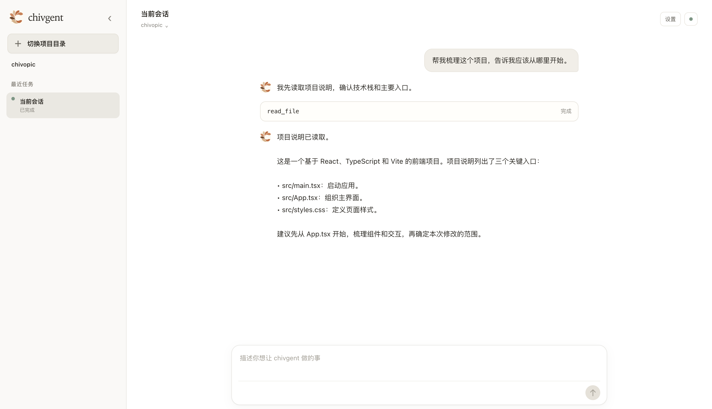
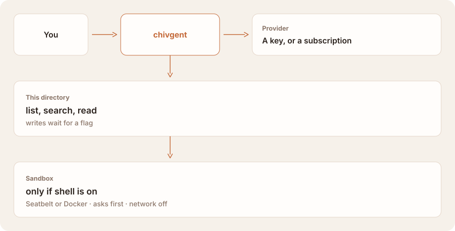

<p align="center">
  <a href="https://chivgent-web.vercel.app/">
    
  </a>
</p>

<div align="center">

# chivgent

### A coding agent in your terminal.

The same category as Claude Code and Codex. You bring the model.

[](https://www.npmjs.com/package/chivgent)
[](https://github.com/chivopic/chivgent/actions/workflows/ci.yml)

[](LICENSE)

**[Website ↗](https://chivgent-web.vercel.app/)** · [Architecture](docs/architecture.md) · [Shell](docs/shell-sandbox.md) · [Sign in](docs/subscription-oauth.md) · **English** · [简体中文](README.zh-CN.md)

</div>

chivgent is a local agent for the directory you have open. The category is the one [Claude Code](https://code.claude.com) and [Codex](https://github.com/openai/codex) occupy: read the project, change it, run it, and come back to the session. The model is yours. An API key, or a ChatGPT or xAI subscription.

The default that category expects is auto mode. Ordinary reads, workspace edits, and sandboxed commands proceed. The agent stops when an action leaves the workspace, or when a command needs the host. Here that policy is `workspace`. It is not a second model reviewing each action, and it is not a bypass. Local interactive rich-TUI sessions start in Ask for me unless a permission mode or legacy capability flag was selected; file changes and commands require approval. Shift+Tab cycles through Plan, Auto mode, and Ask for me. Headless, simple, and remote starts keep their existing defaults.

## Desktop — Coming soon

The desktop app is in active development, bringing project conversations, streaming responses, and tool activity into a focused local workspace. Follow the [development progress and current limits](docs/desktop-architecture.md).



*Development preview using the chivopic sample project and an offline demo conversation.*

## Getting started

You need Node.js 22 or newer.

```bash
npm install -g chivgent
```

Or, on macOS/Linux, use the [official website installer](https://chivgent-web.vercel.app/install.sh). It still requires Node.js 22+ and npm; it installs the same npm package, without using `sudo` or changing your shell configuration.

```bash
curl -fsSL https://chivgent-web.vercel.app/install.sh | bash
```

This runs a script from the Internet. To inspect it first, download it with `curl -fsSLo install.sh https://chivgent-web.vercel.app/install.sh`, read it, then run `bash install.sh`. If npm's global bin directory is missing from PATH, the installer shows the directory to add.


Already installed? `chivgent update --check`, then `chivgent update`.

Start it in the project.

```bash
cd /path/to/project
chivgent
```

No key is required to open the session. Type `/provider` and enter one when asked, or export one first. Keys are saved for your user only, in `~/.chivgent/auth.json`.

```bash
export OPENAI_API_KEY="your-api-key"
```

In a session, `/login oauth openai` or `/login oauth xai` signs in with a subscription. On a normal start, a key still takes precedence. [Subscription sign-in](docs/subscription-oauth.md).

```bash
chivgent "Where is the entry point?"                     # reads, then answers
chivgent --permission-mode workspace "Run tests and fix them"
chivgent --permission-mode ask-first "Review this project"
chivgent --allow-writes "Rename sayHi to greet"         # older flag, not with a mode
chivgent --allow-shell "Run the tests"                  # asks, then Seatbelt or Docker
chivgent --provider deepseek "Explain src/"
chivgent                                                 # rich TUI in a local interactive terminal
chivgent --simple                                        # append-only interface
chivgent --tui                                           # explicitly request the rich TUI
chivgent --continue                                      # last session in this directory
```

## Modes

| Mode | What proceeds | This build |
| --- | --- | --- |
| `workspace` | Workspace edits and sandboxed commands. Network stays off. A command that needs the host asks once, for that command only. | Auto mode in the TUI cycle, or `--permission-mode workspace`. |
| `ask-first` | Reads. Each file change and each command asks. No answer means no action. | Ordinary local rich-TUI start, or `--permission-mode ask-first`. |
| `unrestricted` | Shell commands run with broad host file access and network, inside the OS sandbox. File tools stay in the workspace. | Explicit opt-in. |
| none | Reads. Writes and shell wait for a flag. Commands need interactive approval or explicit approval-all. | `--simple`, headless, and remote starts unless a mode or legacy flag is selected. |

`--permission-mode` replaces the flags for this process. It cannot be combined with `--allow-writes`, `--allow-shell`, `--approve-all-shell`, or `--shell-network`, and it cannot be used with `--serve` or `--connect`. `/permissions` inspects or changes the mode, only in a session that started with one. The choice is not saved in the transcript. Resuming a session uses the mode you selected at startup, not a broader one from last time.

`/plan` is separate. It keeps the agent on read tools and a plan. Writes, shell, and extension tools stay blocked even if the model asks for them.

## How it fits together

You type in the terminal. chivgent calls the provider you picked. File tools stay inside the current directory. The shell runs in a sandbox and does not receive your provider keys. On the default start, the shell is off until you turn it on.

<picture>
  <source media="(prefers-color-scheme: dark)" srcset="docs/assets/fit-dark.svg">
  
</picture>

## What it can touch

This is the build, not the auto-style default above.

| | How | What it can reach |
| --- | --- | --- |
| Read the project | on | This directory. Ignored, generated, and credential paths are skipped. |
| Change files | `--allow-writes` | Files inside the workspace. An edit has to match exactly, and it is written atomically. |
| Run a command | `--allow-shell` | Seatbelt on macOS, Docker elsewhere. Network is off. Each command requires confirmation. |
| Pick a policy | `--permission-mode` | `ask-first`, `workspace`, or `unrestricted`. Replaces the flags for this process. |

You pay the provider you picked, at their prices. chivgent shows token counts; it does not convert them into costs.

## Providers

| Provider | `--provider` | Key | Model |
| --- | --- | --- | --- |
| OpenAI, Responses API | `openai` (default) | `OPENAI_API_KEY` | `gpt-5.6` |
| DeepSeek | `deepseek` | `DEEPSEEK_API_KEY` | `deepseek-v4-flash` |
| Any compatible endpoint | `openai-compatible` | `OPENAI_API_KEY` and `OPENAI_BASE_URL` | set `OPENAI_MODEL` |
| OpenRouter | `openrouter` | `OPENROUTER_API_KEY` | set `OPENROUTER_MODEL` |
| Groq | `groq` | `GROQ_API_KEY` | set `GROQ_MODEL` |
| xAI | `xai` | `XAI_API_KEY` | set `XAI_MODEL` |
| Moonshot | `moonshot` | `MOONSHOT_API_KEY` | set `MOONSHOT_MODEL` |

`--model` overrides the model variable. Keys resolve in this order: `--api-key`, then the environment variable, then `~/.chivgent/auth.json`. A custom base URL receives your key and your prompts. Point it only at an endpoint you trust.

A compatible endpoint must implement `POST /chat/completions` with tool calling. Changing the base URL does not guarantee full compatibility. [Architecture](docs/architecture.md#openai-compatible-providers).

## A session you can come back to

Run `chivgent` with no question for an interactive session. It is saved under `~/.chivgent/sessions`. `--continue` resumes the latest one in this directory. `/resume` lists the others, and only opens sessions from here.

`/compact` summarizes older turns and keeps the full transcript to resume later. `/status` shows the model, the permissions, and token usage. `/help` lists the rest.

Local interactive terminals use the rich TUI by default. `--simple` selects the append-only interface; `--tui` remains available to request the rich TUI explicitly, including when stdout is redirected. Piped input or output, JSON, one-shot runs, `--serve`, and `--connect` keep their existing simple output. `TERM=dumb` selects the simple interface; `NO_COLOR` keeps the rich TUI and disables color. Without legacy capability flags or an explicit permission mode, rich TUI sessions start in Ask for me. Shift+Tab at the idle inline prompt cycles Plan → Auto mode → Ask for me; the footer shows the active provider and model on the left, then the current mode. The compact welcome shows the workspace path and omits the session ID, the provider, and the model; use `/session` or `/status` for full session details. `/help` lists commands and keyboard controls. Explicit `--permission-mode` choices and legacy capability flags retain their behavior. [TUI](docs/tui.md). A long session stays within the context window by summarizing older turns and keeping the list of files read and changed. [Context](docs/architecture.md#context-management).

In its inline editor, type `/` to browse registered commands or keep typing to filter them. Use ↑/↓ to choose a command, then Tab or Enter to fill it into the draft; submit it with Enter afterward. A mouse click fills a visible command, and the wheel browses the menu. Wheel up over the transcript scrolls the terminal's own scrollback; the composer takes the mouse back on the next key. Esc closes the menu and keeps the draft. Fully typed commands still run with one Enter. `/login` lists the Providers before asking for a key, so the key is stored for the one you chose; `/login NAME` skips the list.

## Boundaries

- Paths outside the workspace are rejected, including `..` and symlink escapes. Common credential paths are denied. Tool output is capped.
- Without a mode or legacy flag, `--simple`, headless, and remote starts retain the read-only default. A local rich-TUI start selects `ask-first` for that process unless a legacy capability flag was given. `--allow-shell` needs interactive approval; non-interactive commands are denied unless `--approve-all-shell` was set. A served session denies commands unless you also pass `--approve-all-shell`. If the sandbox cannot start, the command does not run unsandboxed.
- `workspace` runs workspace edits and sandboxed commands on its own, and asks once when a command wants host file and network access. `unrestricted` is the explicit opt-in for broad host access and network. Neither is saved with the session. [Shell safety](docs/shell-sandbox.md).
- The macOS sandbox can still read files your user can read. It restricts writes and network access. It is not confidentiality isolation.
- There is no per-command allowlist, and no native Windows shell. `workspace` is not the start mode of this build.
- Extensions are JavaScript in the chivgent process. Trusting a project means letting its authors run code as you. chivgent prompts once per directory, and does not load extensions when there is no terminal to prompt.
- Keys, subscription credentials, and session logs are owner-only and stored in plain text. Logs contain prompts, answers, and file excerpts.
- `--serve` puts the session on a Unix socket in an owner-only directory. Anyone who can open the socket gets every capability the server started with. There is no TCP listener.

Work on committed code. Use a copy for a repository you do not trust.

This repository also has an Electron desktop app. It opens a project through the native folder picker and runs the same Agent with read-only project tools and a configured Provider. API keys are read from the environment or CLI `auth.json`; the desktop does not store them. Desktop does **not** read `oauth.json` or refresh subscription OAuth tokens. If you signed in using only `/login oauth`, configure an API key before using Desktop. When choosing an OpenAI-compatible Provider, verify the displayed endpoint before sending project content. Desktop keeps one conversation per project, restores the current run after a window refresh, and loads saved history after restart for the user to continue. Interrupted runs are marked unknown and are never automatically replayed; full history navigation and CLI-session import are still pending. For the offline demo, set `CHIVGENT_DESKTOP_DEMO=1`. Build and run the app with `npm run desktop:dev`; offline real-adapter verification uses `npm run desktop:build && node apps/desktop/scripts/verify-readonly.mjs`. [Desktop behavior and limits](docs/desktop-architecture.md).

## Documentation

| | |
| --- | --- |
| [Architecture](docs/architecture.md) | The loop, providers, context, and where the source lives |
| [Shell safety](docs/shell-sandbox.md) | Seatbelt, Docker, and what a command can still read |
| [Subscription sign-in](docs/subscription-oauth.md) | ChatGPT and xAI: what is stored, and what a key still does |
| [TUI](docs/tui.md) | The live region, the editor, and diff review |
| [Evals](docs/evals.md) | Whether the agent finishes the task, separate from the unit tests |
| [Extensions and remote sessions](docs/extensions-and-remote.md) | Tools you add, and attaching another terminal |

## Development

```bash
git clone https://github.com/chivopic/chivgent.git
cd chivgent
npm install
npm test
```

Tests use scripted model clients and do not spend API credits. Issues and focused pull requests are welcome. Keep provider-specific types in `src/providers/`, so the agent does not depend on a vendor SDK.

## License

[MIT](LICENSE)
