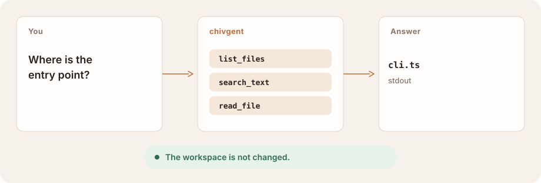

<p align="center">
  
</p>

<div align="center">

# chivgent

### A coding agent in your terminal.

**Ask what this repo does. It reads the files. It does not touch them.**<br>
Writes wait for a flag. The shell waits for a yes, inside a sandbox.

[](https://www.npmjs.com/package/chivgent)
[](https://github.com/chivopic/chivgent/actions/workflows/ci.yml)

[](LICENSE)

[Architecture](docs/architecture.md) · [Shell](docs/shell-sandbox.md) · [Sign in](docs/subscription-oauth.md) · **English** · [简体中文](README.zh-CN.md)

</div>

<br>

<picture>
  <source media="(prefers-color-scheme: dark)" srcset="docs/assets/turn-dark.svg">
  
</picture>

## Is this for you?

You have a project open and a question about it. chivgent asks a model you choose, using the files in the current directory.

- **It starts by reading.** Listing, searching, and reading are on. Nothing is written.
- **You bring the model.** An API key, or a ChatGPT or xAI subscription you sign in with.
- **The boundary is a switch, not a surprise.** Writes require a flag. Each shell command asks, then runs in Seatbelt or Docker. Or pick one permission mode for the whole process.

It runs on your machine. It is not a hosted product. It does not yet support fine-grained permissions, a native Windows shell, or a desktop app you can work in today. Work on a desktop workbench has started in this repository. The terminal is how you use chivgent.

## Quick start

You need Node.js 22 or newer.

**1 · Install.**

```bash
npm install -g chivgent
```

Already installed? `chivgent update --check`, then `chivgent update`.

**2 · Provide a key, or sign in later.**

```bash
export OPENAI_API_KEY="your-api-key"
```

No key is fine. Run `chivgent`, type `/provider`, and enter one when asked. Keys are saved for your user only, in `~/.chivgent/auth.json`.

**3 · Ask, from the project.**

```bash
chivgent "Where is the entry point?"
```

The answer streams to stdout. Tool names appear on stderr. The project is unchanged.

```bash
chivgent --provider deepseek "Explain src/"                  # DeepSeek, same kind of question
chivgent --allow-writes "Rename sayHi to greet"              # files change only with this flag
chivgent --allow-shell "Run the tests"                       # asks before each command, then runs in the sandbox
chivgent --permission-mode workspace "Run tests and fix them" # one policy for this process, instead of the flags
chivgent --permission-mode ask-first "Review this project"   # approve each file change and each command
chivgent --tui                                               # interactive, with a live region
chivgent --continue                                          # resume the last session in this directory
```

In an interactive session, `/login oauth openai` or `/login oauth xai` signs in with a subscription. On normal startup, a key still takes precedence. [Subscription sign-in](docs/subscription-oauth.md).

## How it fits together

You type in the terminal. chivgent calls the provider you picked. File tools stay inside the current directory. The shell, only if you turned it on, runs in a sandbox and does not receive your provider keys.

<picture>
  <source media="(prefers-color-scheme: dark)" srcset="docs/assets/fit-dark.svg">
  
</picture>

## What it can touch

| | Flag | What it can reach |
| --- | --- | --- |
| Read the project | default | This directory. Ignored, generated, and credential paths are skipped. |
| Change files | `--allow-writes` | Files inside the workspace. An edit has to match exactly, and it is written atomically. |
| Run a command | `--allow-shell` | Seatbelt on macOS, Docker elsewhere. Network is off. Each command requires confirmation. |
| Pick a policy | `--permission-mode` | `ask-first`, `workspace`, or `unrestricted`. Replaces the flags above for this process. `/permissions` inspects or changes it. |

You pay the provider you picked, at their prices. chivgent shows token counts; it does not convert them into costs.

## Providers

| Provider | `--provider` | Key | Model |
| --- | --- | --- | --- |
| OpenAI, Responses API | `openai` (default) | `OPENAI_API_KEY` | `gpt-5.6` |
| DeepSeek | `deepseek` | `DEEPSEEK_API_KEY` | `deepseek-v4-flash` |
| Any compatible endpoint | `openai-compatible` | `OPENAI_API_KEY` and `OPENAI_BASE_URL` | set `OPENAI_MODEL` |
| OpenRouter | `openrouter` | `OPENROUTER_API_KEY` | set `OPENROUTER_MODEL` |
| Groq | `groq` | `GROQ_API_KEY` | set `GROQ_MODEL` |
| xAI | `xai` | `XAI_API_KEY` | set `XAI_MODEL` |
| Moonshot | `moonshot` | `MOONSHOT_API_KEY` | set `MOONSHOT_MODEL` |

`--model` overrides the model variable. Keys resolve in this order: `--api-key`, then the environment variable, then `~/.chivgent/auth.json`. A custom base URL receives your key and your prompts. Point it only at an endpoint you trust.

A compatible endpoint must implement `POST /chat/completions` with tool calling. Changing the base URL does not guarantee full compatibility. [Architecture](docs/architecture.md#openai-compatible-providers).

## A session you can come back to

Run `chivgent` with no question for an interactive session. It is saved under `~/.chivgent/sessions`. `--continue` resumes the latest one in this directory. `/resume` lists the others, and only opens sessions from here.

`/plan` keeps the agent on read tools and a plan. Writes, shell, and extension tools stay blocked even if the model asks for them. `/compact` summarizes older turns and keeps the full transcript to resume later. `/status` shows the model, the permissions, and token usage. `/permissions` inspects or changes the mode for this process. `/help` lists the rest.

A permission mode is not saved in the transcript. Resuming a session uses the mode you selected at startup, not a broader one from last time.

`--tui` adds a live status region and a multi-line editor. [TUI](docs/tui-v5.md). A long session stays within the context window by summarizing older turns and keeping the list of files read and changed. [Context](docs/architecture.md#context-management).

## A desktop app is started

This repository also has an Electron app, aimed at a local workbench on the same agent: a project, a task, the work in front of you, the diff after. The current build is a prototype. It is not how you use chivgent today. [Desktop plan](docs/desktop-architecture.md).

## Boundaries

- Paths outside the workspace are rejected, including `..` and symlink escapes. Common credential paths are denied. Tool output is capped.
- `--allow-shell` asks before each command. A headless or served session denies commands unless you also pass `--approve-all-shell`. If the sandbox cannot start, the command does not run unsandboxed.
- `--permission-mode` is a different switch, not a finer one, and it cannot be combined with `--allow-writes` or `--allow-shell`. `ask-first` asks before every file change and every command. `workspace` runs workspace edits and sandboxed commands on its own, and asks once when a command wants host file and network access. `unrestricted` is the explicit opt-in for broad host access and network. None of these is saved with the session. [Shell safety](docs/shell-sandbox.md).
- The macOS sandbox can still read files your user can read. It restricts writes and network access. It is not confidentiality isolation. [Shell safety](docs/shell-sandbox.md).
- Extensions are JavaScript in the chivgent process. Trusting a project means letting its authors run code as you. chivgent prompts once per directory, and does not load extensions when there is no terminal to prompt.
- Keys, subscription credentials, and session logs are owner-only and stored in plain text. Logs contain prompts, answers, and file excerpts.
- `--serve` puts the session on a Unix socket in an owner-only directory. Anyone who can open the socket gets every capability the server started with. There is no TCP listener.

Work on committed code. Use a copy for a repository you do not trust.

## Documentation

| | |
| --- | --- |
| [Architecture](docs/architecture.md) | The loop, providers, context, and where the source lives |
| [Shell safety](docs/shell-sandbox.md) | Seatbelt, Docker, and what a command can still read |
| [Subscription sign-in](docs/subscription-oauth.md) | ChatGPT and xAI: what is stored, and what a key still does |
| [TUI](docs/tui-v5.md) | The live region, the editor, and diff review |
| [Evals](docs/evals.md) | Whether the agent finishes the task, separate from the unit tests |
| [Extensions and remote sessions](docs/extensions-and-remote.md) | Tools you add, and attaching another terminal |

## Development

```bash
git clone https://github.com/chivopic/chivgent.git
cd chivgent
npm install
npm test
```

Tests use scripted model clients and do not spend API credits. Issues and focused pull requests are welcome. Keep provider-specific types in `src/providers/`, so the agent does not depend on a vendor SDK.

## License

[MIT](LICENSE)
