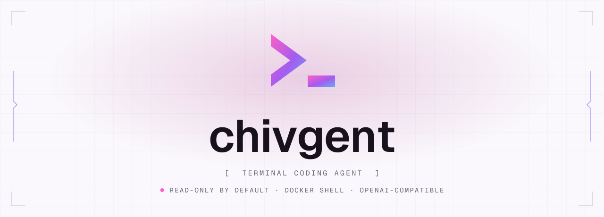

<p align="center">
  <picture>
    <source media="(prefers-color-scheme: dark)" srcset="docs/assets/chivgent-banner-dark.svg">
    
  </picture>
</p>

# chivgent

[English](README.md) | [简体中文](README.zh-CN.md)

[](https://www.npmjs.com/package/chivgent)
[](https://github.com/chivopic/chivgent/actions/workflows/ci.yml)


chivgent is a terminal coding agent you can read end to end. It asks an LLM
(OpenAI, DeepSeek, or any OpenAI-compatible endpoint) about the project in your
current directory, using read-only file tools by default. Choose a permission
mode per process: ask before actions, automatically work within the sandboxed
workspace, or explicitly allow broad shell access.

It is small on purpose: a TypeScript CLI with four runtime dependencies, where
the agent loop, Provider adapters, context compaction, and tool sandboxing are
each a few hundred lines you can study.

**Use it if** you want a coding agent whose every mechanism you can inspect and
change, or a reference implementation for building your own.
**Look elsewhere if** you want the most capable agent for daily work, a hosted
product, a fine-grained permission system, or native Windows shell support.

## Quick start

You need Node.js 22 or newer and an API key for one Provider.

```bash
npm install -g chivgent
chivgent --version
```

This prints the installed version, such as `1.0.0`. Then, from the project you want to ask
about:

```bash
export OPENAI_API_KEY="your-api-key"
chivgent "What does this project do, and where is its entry point?"
```

The answer streams to stdout. Tool activity (`list_files`, `search_text`,
`read_file`) is shown on stderr. Nothing in the project is changed.

Prefer DeepSeek or another Provider? Swap the key and add `--provider`:

```bash
export DEEPSEEK_API_KEY="your-api-key"
chivgent --provider deepseek "Explain the architecture in src/"
```

Run `chivgent` with no question for an interactive session. If no key is set,
the session still starts: type `/provider`, pick one, and enter its key when
asked. Keys are saved owner-only in `~/.chivgent/auth.json`.

**Try it without a key or network:** from a source checkout, `npm run demo:tui`
runs the TUI against a stub Provider and does not touch the workspace.

## What it can do, and what it needs from you

| Capability | Flag | What it can touch |
| --- | --- | --- |
| Discover, search, and read files | default | The current directory only. `.gitignore`d, generated, and credential paths (such as `.env`, `id_rsa`) are skipped. |
| Create and edit files (`write_file`, `edit_file`, `apply_patch`) | `--allow-writes` | Files inside the workspace. Edits are exact-match and atomic. |
| Run shell commands (`bash`) | `--allow-shell` | macOS Seatbelt sandbox by default on macOS; Docker on other supported platforms. Network and workspace writes are denied unless explicitly enabled. Each command needs a `y` to run. |
| Select permission behavior | `--permission-mode ask-first\|workspace\|unrestricted` | `/permissions` inspects or changes it; `/status` shows the active mode. |
| Load project extensions | trust prompt on first run | Anything you can: extensions are in-process JavaScript. |

Costs: chivgent calls the Provider you choose with your key, so you pay that
Provider's normal token prices. It reports token counts per turn and per
session (`/session`) but never converts them to money.

## Providers

| Provider | `--provider` | API key variable | Default model |
| --- | --- | --- | --- |
| OpenAI (Responses API) | `openai` (default) | `OPENAI_API_KEY` | `gpt-5.6` |
| DeepSeek | `deepseek` | `DEEPSEEK_API_KEY` | `deepseek-v4-flash` |
| Any OpenAI-compatible endpoint | `openai-compatible` | `OPENAI_API_KEY` + `OPENAI_BASE_URL` | set `OPENAI_MODEL` |
| OpenRouter | `openrouter` | `OPENROUTER_API_KEY` | set `OPENROUTER_MODEL` |
| Groq | `groq` | `GROQ_API_KEY` | set `GROQ_MODEL` |
| xAI | `xai` | `XAI_API_KEY` | set `XAI_MODEL` |
| Moonshot | `moonshot` | `MOONSHOT_API_KEY` | set `MOONSHOT_MODEL` |

`--model` overrides the model variable. Keys resolve in this order: `--api-key`,
then the environment variable, then `~/.chivgent/auth.json` (literal keys only;
no `$VAR` expansion or command substitution). A custom `OPENAI_BASE_URL`
receives your key and prompts, so point it only at endpoints you trust.

Compatible endpoints must implement `POST /chat/completions` with function tool
calling. Changing only the base URL does not guarantee full compatibility; see
[architecture](docs/architecture.md#openai-compatible-providers).

## Everyday use

```bash
chivgent                                   # interactive session
chivgent --continue                        # resume the latest session here
chivgent --permission-mode workspace "Run tests and fix failures"
chivgent --permission-mode ask-first "Review this project"
chivgent --allow-writes "Rename sayHi to greet everywhere"
chivgent --allow-shell --approve-all-shell "Run the tests and explain the failure"
chivgent --json "List the CLI flags" > run.jsonl   # machine-readable events
```

Select a shell backend with `--shell-backend auto|native|docker` (`auto` uses
Seatbelt on macOS and Docker elsewhere). Permission modes are described in
[shell safety](docs/shell-sandbox.md). They are not saved in transcripts, so a
resumed session uses the mode selected at startup.

- **Interactive sessions** keep history across prompts and are saved as JSON
  lines under `~/.chivgent/sessions` (`--no-session` to skip). `/help` lists
  slash commands such as `/provider`, `/model`, `/login`, `/session`, `/diff`,
  `/status`, `/compact`, `/plan`, `/new`, `/resume`, and `/rename`. `/new` saves
  the current session and starts a fresh one; `/resume` lists IDs when omitted
  and only switches to sessions from the current workspace. Ctrl+C stops a
  running answer; at an idle prompt it exits.
- **Plan Mode** (`/plan`, `/plan on`, `/plan off`) persists with the session.
  The agent can use exact built-in read tools and `update_plan`; the execution
  layer blocks writes, Shell, and extension tools even if a Provider requests
  them. New sessions start with Plan Mode off.
- **Manual compaction** (`/compact`) saves a model-facing checkpoint while
  retaining the complete transcript for resume. It is unavailable with
  `--no-compaction`. `/status` shows the active model, permissions, session
  state, usage, and an approximate token estimate scoped to transcript messages.
- **`--tui`** adds a live status region and a multi-line editor with history,
  an inline `/` command menu, and `/gitdiff` review. See the
  [TUI guide](docs/tui-v5.md).
- **Long sessions** stay inside the context window: older turns are summarised,
  while the list of files read and changed is kept from the tool calls
  themselves. See [architecture](docs/architecture.md#context-management).
- **Exit codes:** `0` answered, `1` configuration or Provider failure, `2` turn
  limit reached, `130` interrupted.
- **Updating:** `chivgent update --check`, then `chivgent update`. See
  [updating](docs/updating.md).

`chivgent --help` prints every flag.

## Security model

chivgent states its boundaries rather than pretending to enforce fine-grained
ones. Permission modes are process-local policies, with one-command approval
for explicitly requested host shell access.

- File tools reject paths outside the workspace, including `..` traversal and
  symlink escapes, and deny common credential and private-key paths. Tool output
  is capped at 64 KiB.
- Legacy `--allow-shell` runs each command in a macOS Seatbelt sandbox or fresh Docker
  container and asks before each one. Writes and network are denied by default;
  use `--allow-writes` and `--shell-network` to opt in. Headless and served
  sessions deny commands unless you also pass `--approve-all-shell`. The
  `workspace` mode automatically runs sandboxed workspace commands, while a
  requested host scope requires one-command approval. Native mode uses a
  deny-then-allow path policy that preserves selected system/toolchain reads;
  it is not a complete filesystem allowlist. Details:
  [shell sandbox](docs/shell-sandbox.md).
- Writes and trusted extensions are **not** inside the container. Trusting a
  project's extensions means letting its authors run code as you, so chivgent
  asks once per directory and never loads them when there is no terminal to ask.
- `auth.json`, session logs, and `trust.json` are written owner-only but in
  plain text. Session logs contain prompts, answers, and file excerpts.
- `--serve` exposes a session on a Unix socket in an owner-only directory.
  Anyone who can open the socket gets every capability the server started with.
  There is no TCP listener; use SSH forwarding for another machine.

Work on committed code, and use a disposable copy for repositories you don't
trust.

## Going deeper

- [Architecture](docs/architecture.md): agent loop, runtime events, context
  compaction, Provider adapters, the TUI live region, and the source layout.
- [Evals and token usage](docs/evals.md): ten deterministic task suites that
  measure pass rates over repeated attempts, separate from the free, offline
  unit tests.
- [Extensions and remote sessions](docs/extensions-and-remote.md): adding
  tools and slash commands, project trust, and attaching several terminals to
  one session.
- [Patch format](docs/apply-patch.md), [scoped `AGENTS.md`](docs/scoped-agents-md.md),
  [parallel read tools](docs/parallel-read-tools.md),
  [plan tracking](docs/agent-plan-progress.md).
- Design notes for each build stage, from
  [stage 1](docs/stage-1-minimal-agent.md) to [stage 14](docs/stage-14-tui.md),
  and the [release process](docs/releasing.md).

## Development

```bash
git clone https://github.com/chivopic/chivgent.git
cd chivgent
npm install
npm run check
npm test
npm run build
```

Tests use scripted LLM clients and never spend API credits.
`npm run release:check` runs the full gate, including an `npm pack` dry run.
To try the checkout as a global command: `npm install -g .`

Issues and focused pull requests are welcome. Keep Provider-specific types in
`src/providers/` so the agent runtime stays independent of vendor SDKs.

## License

[MIT](LICENSE)
