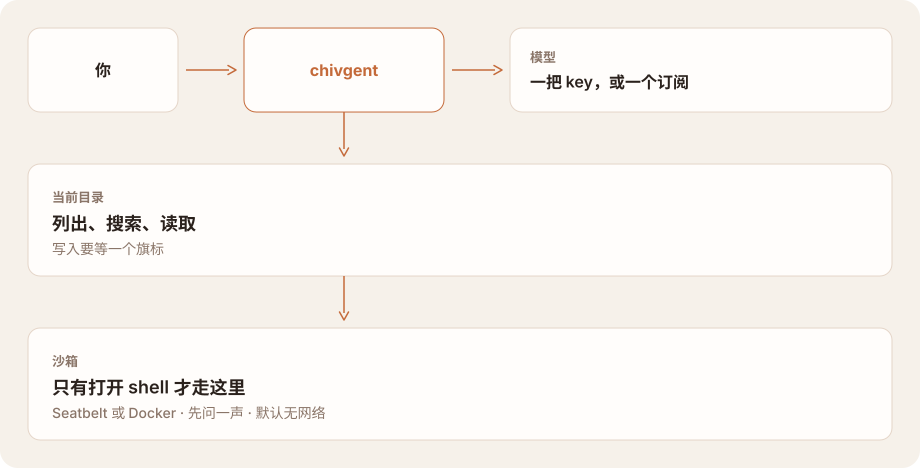

<p align="center">
  <a href="https://chivgent-web.vercel.app/">
    
  </a>
</p>

<div align="center">

# chivgent

### 终端里的 coding agent。

和 Claude Code、Codex 同一类。模型你自己带。

[](https://www.npmjs.com/package/chivgent)
[](https://github.com/chivopic/chivgent/actions/workflows/ci.yml)

[](LICENSE)

**[官网 ↗](https://chivgent-web.vercel.app/)** · [架构](docs/architecture.md) · [Shell](docs/shell-sandbox.md) · [登录](docs/subscription-oauth.md) · [English](README.md) · **简体中文**

</div>

chivgent 是跑在你打开的目录里的本地 agent。它要做的，是 [Claude Code](https://code.claude.com) 和 [Codex](https://github.com/openai/codex) 那一类事：读这个项目，改它，跑它，会话还能回来。模型是你的。一把 API key，或者 ChatGPT、xAI 订阅。

这一类现在的默认是 auto mode。工作区内的读取、编辑，以及沙箱里的命令，直接进行。动作离开工作区，或者命令要用宿主机，就停。这里这个策略叫 `workspace`。它不是另一个模型在逐条审查，也不是跳过所有边界。本地交互式 rich TUI 在没有指定权限模式或旧权限开关时默认使用 Ask for me：文件修改和命令都要确认；在空闲输入框按 Shift+Tab 可在 Plan、Auto mode 和 Ask for me 之间循环。headless、simple 和远程启动保留原有默认值。

## 桌面版 — 开发中 / Coming soon

桌面版正在开发中，将项目会话、流式回答和工具活动集中到一个简洁的本地工作台。欢迎关注[开发进展与当前能力](docs/desktop-architecture.md)。


*开发预览：chivopic 示例项目与离线演示对话。*

## 快速开始

需要 Node.js 22 或更高版本。

```bash
npm install -g chivgent
```

macOS/Linux 用户也可以通过[官网一键安装脚本](https://chivgent-web.vercel.app/install.sh)安装。仍需提前装好 Node.js 22+ 和 npm；脚本安装的是同一个 npm 包，不会自动调用 `sudo` 或修改 Shell 配置。

```bash
curl -fsSL https://chivgent-web.vercel.app/install.sh | bash
```

这会直接执行从网上下载的脚本。更稳妥的做法是先运行 `curl -fsSLo install.sh https://chivgent-web.vercel.app/install.sh`，阅读内容后再运行 `bash install.sh`。如果 npm 全局命令目录不在 PATH 里，脚本会提示需要添加的目录。


已经安装过？先 `chivgent update --check`，再 `chivgent update`。

在项目目录里启动。

```bash
cd /path/to/project
chivgent
```

没有 key 也能打开会话。输入 `/provider`，按提示填入，或先导出一把。key 只给当前用户读，保存在 `~/.chivgent/auth.json`。

```bash
export OPENAI_API_KEY="your-api-key"
```

在交互会话里，`/login oauth openai` 或 `/login oauth xai` 用订阅登录。平常启动时，key 仍然优先。[订阅登录](docs/subscription-oauth.md)。

```bash
chivgent "入口在哪？"                                # 读完再答
chivgent --permission-mode workspace "跑测试并修掉"
chivgent --permission-mode ask-first "审这个项目"
chivgent --allow-writes "把 sayHi 改成 greet"        # 旧开关，不能和模式一起用
chivgent --allow-shell "跑测试"                      # 先确认，再进 Seatbelt 或 Docker
chivgent --provider deepseek "讲讲 src/"
chivgent                                             # 本地交互终端默认使用 rich TUI
chivgent --simple                                    # 使用追加式界面
chivgent --tui                                       # 显式请求 rich TUI
chivgent --continue                                  # 这个目录里的上一次会话
```

## 模式

| 模式 | 能直接进行的 | 这一版 |
| --- | --- | --- |
| `workspace` | 工作区内的修改和沙箱命令。网络关着。命令要用宿主机时，只为这一条问一次。 | TUI 循环中的 Auto mode，或 `--permission-mode workspace`。 |
| `ask-first` | 读取。每次改文件、每条命令都要确认。没有答复就没有动作。 | 普通本地 rich TUI 启动，或 `--permission-mode ask-first`。 |
| `unrestricted` | shell 命令带着宽宿主机文件访问和网络运行，仍在操作系统沙箱里。文件工具不出工作区。 | 显式选择。 |
| 无 | 读取。写入和 shell 等开关。需要交互式确认或显式全批准。 | `--simple`、headless 和远程启动，除非指定模式或旧权限开关。 |

`--permission-mode` 在这个进程里代替那些开关。不能和 `--allow-writes`、`--allow-shell`、`--approve-all-shell`、`--shell-network` 一起用，也不能和 `--serve`、`--connect` 一起用。`/permissions` 查看或更改模式，但只有启动时选了模式的会话才行。这个选择不写进会话记录。恢复会话时用的是启动时选的模式，不是上次更宽的那个。

`/plan` 是另一件事。它让 agent 停在只读工具和一份计划上。即使模型要求，写入、shell 和扩展工具也会被挡住。

## 它怎么接在一起

你在终端里打字。chivgent 调用你选的模型。文件工具不出当前目录。shell 在沙箱里运行，拿不到你的模型 key。默认启动时，shell 要打开才出现。

<picture>
  <source media="(prefers-color-scheme: dark)" srcset="docs/assets/fit-zh-dark.svg">
  
</picture>

## 它能碰到什么

下面是这一版，不是上面那个 auto 式默认。

| | 怎么开 | 能碰到什么 |
| --- | --- | --- |
| 读这个项目 | 开着 | 当前目录。被忽略的、生成的和凭据路径会跳过。 |
| 改文件 | `--allow-writes` | 工作区内的文件。修改必须精确匹配，写入是原子的。 |
| 跑命令 | `--allow-shell` | macOS 用 Seatbelt，其他系统用 Docker。默认没有网络。每条命令都要确认。 |
| 选一种策略 | `--permission-mode` | `ask-first`、`workspace` 或 `unrestricted`。在这个进程里代替上面的开关。 |

费用付给你选的供应商，按他们的价格。chivgent 显示 token 数，不折算成费用。

## 模型

| 供应商 | `--provider` | Key | 模型 |
| --- | --- | --- | --- |
| OpenAI，Responses API | `openai`（默认） | `OPENAI_API_KEY` | `gpt-5.6` |
| DeepSeek | `deepseek` | `DEEPSEEK_API_KEY` | `deepseek-v4-flash` |
| 任何兼容端点 | `openai-compatible` | `OPENAI_API_KEY` 和 `OPENAI_BASE_URL` | 设置 `OPENAI_MODEL` |
| OpenRouter | `openrouter` | `OPENROUTER_API_KEY` | 设置 `OPENROUTER_MODEL` |
| Groq | `groq` | `GROQ_API_KEY` | 设置 `GROQ_MODEL` |
| xAI | `xai` | `XAI_API_KEY` | 设置 `XAI_MODEL` |
| Moonshot | `moonshot` | `MOONSHOT_API_KEY` | 设置 `MOONSHOT_MODEL` |

`--model` 覆盖模型变量。key 按这个顺序找：`--api-key`，然后环境变量，然后 `~/.chivgent/auth.json`。自定义的 base URL 会收到你的 key 和提示词。只把它指向你信任的端点。

兼容端点必须实现支持工具调用的 `POST /chat/completions`。只换 base URL，并不保证完全兼容。[架构](docs/architecture.md#openai-compatible-providers)。

## 会话还在

不带问题运行 `chivgent`，就是一次交互会话。会话保存在 `~/.chivgent/sessions`。`--continue` 恢复这个目录里最近的一次。`/resume` 列出其余的，并且只打开这里的会话。

`/compact` 压缩较早的轮次，完整记录仍留着，方便恢复。`/status` 显示模型、权限和 token 用量。其余的，`/help`。

本地交互终端默认使用 rich TUI。`--simple` 选择追加式界面；`--tui` 仍可显式请求 rich TUI，包括将 stdout 重定向时。管道输入或输出、JSON、单次提问、`--serve` 和 `--connect` 保持原有简单输出。`TERM=dumb` 自动选择简单界面；设置 `NO_COLOR` 时仍使用 rich TUI，但不输出颜色。没有旧权限开关或显式权限模式时，rich TUI 默认使用 Ask for me。空闲输入框中的 Shift+Tab 可循环切换 Plan → Auto mode → Ask for me，页脚左侧显示当前供应商和模型，并显示当前模式。简洁欢迎信息显示工作区路径，不显示 session ID、供应商和模型；用 `/session` 或 `/status` 查看完整信息，`/help` 查看命令和快捷键。显式 `--permission-mode` 和旧权限开关继续按原有方式工作。[TUI](docs/tui.md)。长会话会压缩较早的轮次，并留下读过和改过的文件列表，从而留在上下文窗口里。[上下文](docs/architecture.md#context-management)。

在内联编辑器中输入 `/` 可浏览已注册命令，继续输入可筛选命令。用 ↑/↓ 选择命令，再按 Tab 或 Enter 将其补全到草稿；之后按 Enter 提交。鼠标单击可补全可见命令，滚轮可浏览菜单。在记录区向上滚动时，滚轮会交还终端并滚动终端自己的滚动历史；下一次按键时输入框重新接管鼠标。Esc 关闭菜单并保留草稿。完整输入的命令仍可直接按一次 Enter 执行。`/login` 会先列出供应商再询问 Key，Key 存入你所选的那一个；`/login NAME` 跳过列表。

## 边界

- 工作区以外的路径会被拒绝，包括 `..` 和符号链接逃逸。常见凭据路径会被拒绝。工具输出有上限。
- 没有选模式或旧权限开关时，`--simple`、headless 和远程启动仍为只读。本地 rich TUI 启动会为当前进程选择 `ask-first`，除非指定了旧权限开关。`--allow-shell` 需要交互式确认；非交互式命令除非指定 `--approve-all-shell`，否则会被拒绝。`--serve` 会话除非同时加上 `--approve-all-shell`，否则拒绝命令。沙箱起不来，命令不会改到无沙箱运行。
- `workspace` 自动执行工作区内的修改和沙箱命令，命令要访问宿主机文件和网络时问一次。`unrestricted` 是显式选择的宽宿主机访问和网络。这些都不随会话保存。[Shell 安全](docs/shell-sandbox.md)。
- macOS 沙箱仍然能读当前用户能读的文件。它限制的是写入和网络，不是机密隔离。
- 还没有按命令的允许列表，也没有原生 Windows shell。`workspace` 不是这一版的启动模式。
- 扩展是跑在 chivgent 进程里的 JavaScript。信任一个项目，就是允许它的作者以你的身份执行代码。每个目录问一次；没有终端可问时，不加载。
- key、订阅凭据和会话日志只对文件所有者可读，而且是明文。日志里有提示词、回答和文件摘录。
- `--serve` 把会话放在仅所有者可进的目录里的 Unix socket 上。谁能打开这个 socket，谁就拿到服务器启动时的全部能力。没有 TCP 监听。

在已提交的代码上工作。不信任的仓库，用一份副本。

这个仓库还包含 Electron 桌面应用。它通过原生目录选择器打开项目，并用同一 Agent 和只读项目工具运行已配置的 Provider。桌面端仅从环境变量或 CLI `auth.json` 读取 API Key，不保存凭证；它不会读取 `oauth.json` 或刷新订阅 OAuth 凭证。仅通过 `/login oauth` 登录的用户，使用桌面端前还需配置 API Key。选择兼容 Provider 时，请先核对界面显示的请求端点，再发送项目内容。目前每个项目保留一个会话：窗口刷新可恢复当前运行，应用重启后加载历史供用户主动续聊。中断运行标记为结果未知，不自动重放；完整历史导航和 CLI 会话导入仍待实现。设置 `CHIVGENT_DESKTOP_DEMO=1` 可显式启用离线演示。使用 `npm run desktop:dev` 开发；离线真实 adapter 验收运行 `npm run desktop:build && node apps/desktop/scripts/verify-readonly.mjs`。[桌面行为与限制](docs/desktop-architecture.md)。

## 文档

| | |
| --- | --- |
| [架构](docs/architecture.md) | 循环、供应商、上下文，以及源码在哪 |
| [Shell 安全](docs/shell-sandbox.md) | Seatbelt、Docker，以及一条命令仍能读到什么 |
| [订阅登录](docs/subscription-oauth.md) | ChatGPT 和 xAI：存了什么，key 仍然做什么 |
| [TUI](docs/tui.md) | 实时状态区、编辑器、diff 审阅 |
| [Evals](docs/evals.md) | agent 能不能把活干完，和单元测试分开 |
| [扩展与远程会话](docs/extensions-and-remote.md) | 你加的工具，以及另一个终端怎么接上来 |

## 开发

```bash
git clone https://github.com/chivopic/chivgent.git
cd chivgent
npm install
npm test
```

测试用脚本化的模型客户端，不花 API 额度。欢迎 issue，也欢迎范围清楚的 pull request。供应商专有的类型留在 `src/providers/`，这样 agent 不依赖某一家的 SDK。

## 许可证

[MIT](LICENSE)
