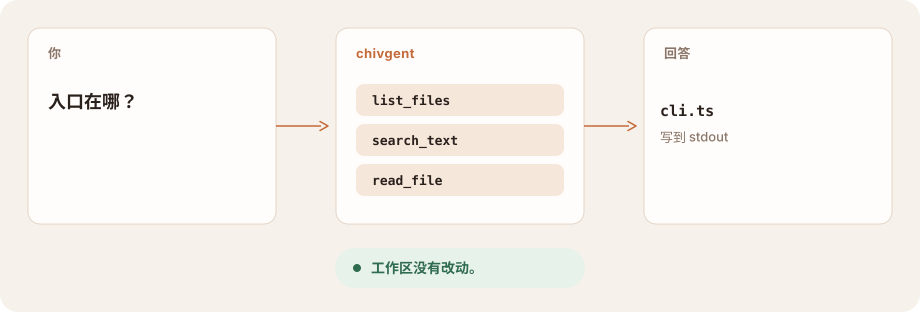

<p align="center">
  
</p>

<div align="center">

# chivgent

### 终端里的 coding agent。

**问这个仓库是做什么的。它去读文件。它不动文件。**<br>
写入需要显式开启。shell 等你确认后，才进沙箱运行。

[](https://www.npmjs.com/package/chivgent)
[](https://github.com/chivopic/chivgent/actions/workflows/ci.yml)

[](LICENSE)

[架构](docs/architecture.md) · [Shell](docs/shell-sandbox.md) · [登录](docs/subscription-oauth.md) · [English](README.md) · **简体中文**

</div>

<br>

<picture>
  <source media="(prefers-color-scheme: dark)" srcset="docs/assets/turn-zh-dark.svg">
  
</picture>

## 适合你吗

你打开了一个项目，有问题要弄明白。chivgent 用你选的模型，看当前目录里的文件。

- **先读。** 列出、搜索、读取默认开着。什么都不写。
- **模型你自己带。** 一把 API key，或者登录你的 ChatGPT、xAI 订阅。
- **边界是开关，不是意外。** 写入需要显式开启。每条 shell 命令先确认，再进入 Seatbelt 或 Docker。也可以为整个进程选一种权限模式。

它跑在你的机器上，不是托管产品。它还没有细粒度权限，没有原生 Windows shell，也还没有一个今天就能开工的桌面版。桌面工作台在这个仓库里已经开始了。今天用 chivgent，用终端。

## 快速开始

需要 Node.js 22 或更高版本。

**1 · 安装。**

```bash
npm install -g chivgent
```

已经安装过？先 `chivgent update --check`，再 `chivgent update`。

**2 · 配一把 key，或稍后登录。**

```bash
export OPENAI_API_KEY="your-api-key"
```

没有 key 也没关系。直接运行 `chivgent`，输入 `/provider`，按提示填入。key 只给当前用户读，保存在 `~/.chivgent/auth.json`。

**3 · 在项目目录里问。**

```bash
chivgent "入口在哪？"
```

回答流式输出到 stdout。工具名出现在 stderr。项目没有改动。

```bash
chivgent --provider deepseek "讲讲 src/"           # 换 DeepSeek，问法一样
chivgent --allow-writes "把 sayHi 改成 greet"      # 只有加上这个参数才会改文件
chivgent --allow-shell "跑测试"                    # 每条命令先确认，再进沙箱
chivgent --permission-mode workspace "跑测试并修掉" # 用一种策略代替上面的开关
chivgent --permission-mode ask-first "审这个项目"   # 每次改文件、每条命令都要确认
chivgent --tui                                     # 交互会话，带一块实时状态
chivgent --continue                                # 恢复这个目录里的上一次会话
```

在交互会话里，`/login oauth openai` 或 `/login oauth xai` 用订阅登录。平常启动时，key 仍然优先。[订阅登录](docs/subscription-oauth.md)。

## 它怎么接在一起

你在终端里打字。chivgent 调用你选的模型。文件工具不出当前目录。shell 只有打开才运行，在沙箱里，拿不到你的模型 key。

<picture>
  <source media="(prefers-color-scheme: dark)" srcset="docs/assets/fit-zh-dark.svg">
  
</picture>

## 它能碰到什么

| | 参数 | 能碰到什么 |
| --- | --- | --- |
| 读这个项目 | 默认 | 当前目录。被忽略的、生成的和凭据路径会跳过。 |
| 改文件 | `--allow-writes` | 工作区内的文件。修改必须精确匹配，写入是原子的。 |
| 跑命令 | `--allow-shell` | macOS 用 Seatbelt，其他系统用 Docker。默认没有网络。每条命令都要确认。 |
| 选一种策略 | `--permission-mode` | `ask-first`、`workspace` 或 `unrestricted`。在这个进程里代替上面的开关。`/permissions` 查看或更改。 |

费用付给你选的供应商，按他们的价格。chivgent 显示 token 数，不折算成费用。

## 模型

| 供应商 | `--provider` | Key | 模型 |
| --- | --- | --- | --- |
| OpenAI，Responses API | `openai`（默认） | `OPENAI_API_KEY` | `gpt-5.6` |
| DeepSeek | `deepseek` | `DEEPSEEK_API_KEY` | `deepseek-v4-flash` |
| 任何兼容端点 | `openai-compatible` | `OPENAI_API_KEY` 和 `OPENAI_BASE_URL` | 设置 `OPENAI_MODEL` |
| OpenRouter | `openrouter` | `OPENROUTER_API_KEY` | 设置 `OPENROUTER_MODEL` |
| Groq | `groq` | `GROQ_API_KEY` | 设置 `GROQ_MODEL` |
| xAI | `xai` | `XAI_API_KEY` | 设置 `XAI_MODEL` |
| Moonshot | `moonshot` | `MOONSHOT_API_KEY` | 设置 `MOONSHOT_MODEL` |

`--model` 覆盖模型变量。key 按这个顺序找：`--api-key`，然后环境变量，然后 `~/.chivgent/auth.json`。自定义的 base URL 会收到你的 key 和提示词。只把它指向你信任的端点。

兼容端点必须实现支持工具调用的 `POST /chat/completions`。只换 base URL，并不保证完全兼容。[架构](docs/architecture.md#openai-compatible-providers)。

## 会话还在

不带问题运行 `chivgent`，就是一次交互会话。会话保存在 `~/.chivgent/sessions`。`--continue` 恢复这个目录里最近的一次。`/resume` 列出其余的，并且只打开这里的会话。

`/plan` 让 agent 停在只读工具和一份计划上。即使模型要求，写入、shell 和扩展工具也会被挡住。`/compact` 压缩较早的轮次，完整记录仍留着，方便恢复。`/status` 显示模型、权限和 token 用量。`/permissions` 查看或更改这个进程的模式。其余的，`/help`。

权限模式不写进会话记录。恢复会话时用的是启动时选的模式，不是上次更宽的那个。

`--tui` 加上实时状态区和多行编辑器。[TUI](docs/tui-v5.md)。长会话会压缩较早的轮次，并留下读过和改过的文件列表，从而留在上下文窗口里。[上下文](docs/architecture.md#context-management)。

## 桌面版开始了

这个仓库里还有一个 Electron 应用。目标是同一个 agent 上的本地工作台：一个项目，一项任务，手头的工作，做完后的 diff。当前构建是原型。今天不要用它来开工。[桌面规划](docs/desktop-architecture.md)。

## 边界

- 工作区以外的路径会被拒绝，包括 `..` 和符号链接逃逸。常见凭据路径会被拒绝。工具输出有上限。
- `--allow-shell` 在每条命令前确认。没有终端的运行，以及 `--serve` 起来的会话，除非同时加上 `--approve-all-shell`，否则拒绝命令。沙箱起不来，命令不会改到无沙箱运行。
- `--permission-mode` 是另一种开关，不是更细的开关，也不能和 `--allow-writes`、`--allow-shell` 一起用。`ask-first` 每次改文件、每条命令都要确认。`workspace` 自动执行工作区内的修改和沙箱命令，命令要访问宿主机文件和网络时问一次。`unrestricted` 是显式选择的宽宿主机访问和网络。这些都不随会话保存。[Shell 安全](docs/shell-sandbox.md)。
- macOS 沙箱仍然能读当前用户能读的文件。它限制的是写入和网络，不是机密隔离。[Shell 安全](docs/shell-sandbox.md)。
- 扩展是跑在 chivgent 进程里的 JavaScript。信任一个项目，就是允许它的作者以你的身份执行代码。每个目录问一次；没有终端可问时，不加载。
- key、订阅凭据和会话日志只对文件所有者可读，而且是明文。日志里有提示词、回答和文件摘录。
- `--serve` 把会话放在仅所有者可进的目录里的 Unix socket 上。谁能打开这个 socket，谁就拿到服务器启动时的全部能力。没有 TCP 监听。

在已提交的代码上工作。不信任的仓库，用一份副本。

## 文档

| | |
| --- | --- |
| [架构](docs/architecture.md) | 循环、供应商、上下文，以及源码在哪 |
| [Shell 安全](docs/shell-sandbox.md) | Seatbelt、Docker，以及一条命令仍能读到什么 |
| [订阅登录](docs/subscription-oauth.md) | ChatGPT 和 xAI：存了什么，key 仍然做什么 |
| [TUI](docs/tui-v5.md) | 实时状态区、编辑器、diff 审阅 |
| [Evals](docs/evals.md) | agent 能不能把活干完，和单元测试分开 |
| [扩展与远程会话](docs/extensions-and-remote.md) | 你加的工具，以及另一个终端怎么接上来 |

## 开发

```bash
git clone https://github.com/chivopic/chivgent.git
cd chivgent
npm install
npm test
```

测试用脚本化的模型客户端，不花 API 额度。欢迎 issue，也欢迎范围清楚的 pull request。供应商专有的类型留在 `src/providers/`，这样 agent 不依赖某一家的 SDK。

## 许可证

[MIT](LICENSE)
